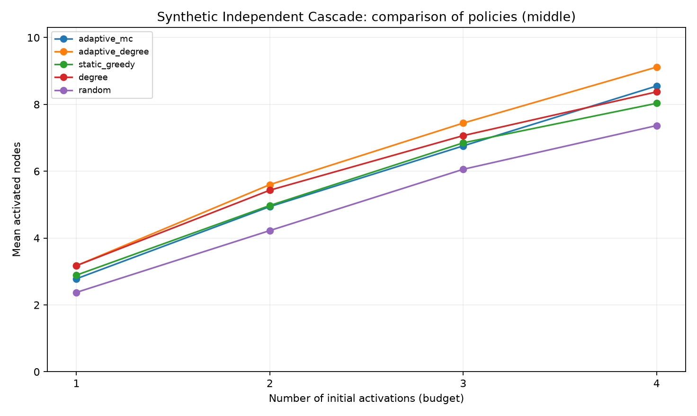
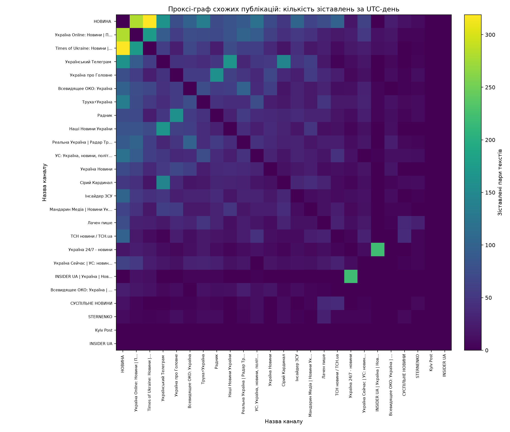

# Telegram content-similarity graph & adaptive information diffusion

**Python / NLP / графові алгоритми · експериментальний проєкт, 2026**

## Задача

На реальних публічних повідомленнях українських Telegram-каналів побудувати **граф тематичної подібності**, а потім порівняти статичні й адаптивні стратегії вибору вузлів у **синтетичній** моделі інформаційного поширення.

## Що зроблено

- Вхідний корпус: **35 750** публікацій за вересень 2026 року, **25 852** текстів після відбору для основного аналізу.
- Порівняння текстів: **TF-IDF + cosine similarity**; знайдено **8 495 пар** близьких публікацій.
- Тематичний граф: **25** назв каналів і **222** неорієнтовані зв’язки між ними.
- Пілотний NLP-класифікатор емоційного оформлення тексту; мала навчальна вибірка, якість не слід узагальнювати на всю сукупність.
- Модель **Independent Cascade**, статичні й адаптивні стратегії, серії Monte Carlo, часово-коректна перевірка.

## Результат

За середньої модельної інтенсивності та бюджетом у 4 початкові вузли: **Adaptive Degree — 9,117** активованих вузлів у середньому; **Static Greedy — 8,033**. Це результати **симуляції**, а не фактичні репости чи підтверджений психологічний вплив.

## Що лежить у репозиторії

Python-скрипти етапів 1–10, методичні описи, контрольні CSV та збережені графіки. Великий корпус, 25-МБ проміжний JSONL, 13-МБ файл усіх прогнозів, `.venv` та локальні IDE-файли **не включені**.

## Як повторити

- Початкова точка: `telegram_stage1_inspect.py`. Джерело корпусу вказано у скрипті (публічний датасет Aisberg на Hugging Face).
- Подальші етапи залежать від підготовлених файлів попередніх кроків. Для повного запуску потрібно отримати вхідний корпус і пройти етапи за порядком.
- Якщо треба лише **показати результати**, відкрийте PNG-файли та порівняйте таблиці `results_september_stage8/stage8_results.csv` і `results_september_stage10/stage10_results.csv`.
- Це **не online-dashboard** і не live-аналіз Telegram.

**Роль AI:** під час пілотної емоційної розмітки використовувалися AI-assisted чернеткові мітки з ручним переглядом; це не незалежний еталонний розмічений датасет. Код і оцінювання мають окрему методологію.
